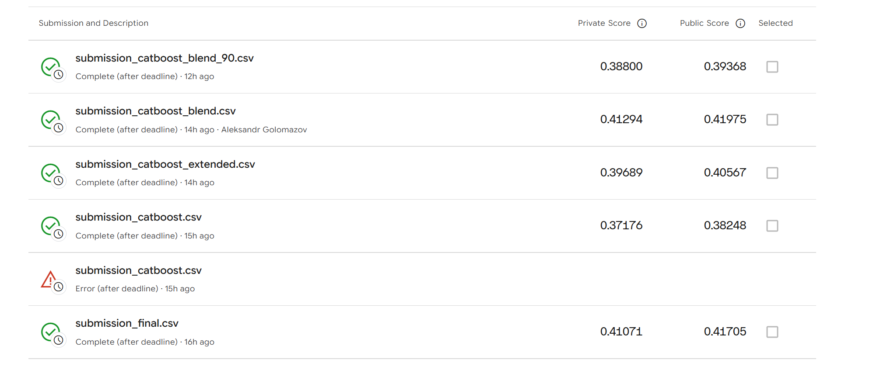

# SWEET.TV TV Program Recommender
## Final Project Report

**Evidence date:** 1 November 2026. **Scope:** implemented recommendation methods, audited offline results, user-level business analysis, and a separate supervised reranking experiment.

### Abstract

This project ranks five television programme IDs per user using implicit viewing histories and a known broadcast schedule. The classical study evaluates popularity, repeat-history heuristics, item-based collaborative filtering, implicit matrix factorisation, personalised graph diffusion, and their implemented hybrids. A reproducible audit separates the original notebook protocol from training that excludes viewing after the validation boundary. The primary comparison covers 4,030 validation users and a shared catalog of 1,867 train-known, future-scheduled programme IDs. The four-component history–CF–ALS–PPR hybrid achieves MAP@5 of **0.367811**, compared with **0.279391** for popularity. Two contrasting users show both its benefit and its failure: the hybrid reaches AP@5 of 0.52 for a category-concentrated viewer but 0 for a diverse viewer. Additional supervised experiments and the supplied Kaggle screenshot are reported separately, with explicit qualifications concerning candidate selection, notebook state, and metric definitions. No online engagement, revenue, or A/B-test outcome is inferred.

## 1. Introduction and Task Definition

The objective is to recommend an ordered list of five distinct `tv_show_id` values to each user. An item is a programme identifier, which can occur in multiple broadcasts and episode-specific titles; it is not necessarily a unique episode or a single airing. Recommendations must be available in the relevant future schedule. Recommending previously watched programmes is permitted and important for repeat television viewing.

Observed interaction means a qualified programme viewing inferred from interval overlap, not a click or an explicit rating. Validation relevance is restricted to each eligible user's five most frequently watched held-out programme IDs. The target metric is mean average precision at five (MAP@5), defined in Section 4. Offline recovery of those future IDs is the measured objective. User satisfaction and commercial impact remain unmeasured.

## 2. Dataset and Preprocessing

### 2.1. Inputs and temporal scope

| Input | Rows in saved notebook output | Role |
| --- | --- | --- |
| `dataset11-30.csv` | 5,821,987 | Viewing intervals, weeks 11–30 |
| `export_arh_11-20-final.csv` | 1,074,235 | Earlier broadcast schedule |
| `export_arh_21-30-final.csv` | 1,074,394 | Validation-period broadcast schedule |
| `export_arh_31-42-final.csv` | 1,295,378 | Future submission schedule |
| `submission.csv` | 1,260 | User IDs and submission schema |

The recorded history spans **9 March 2020 00:00:02 to 26 July 2020 23:59:58**, covering 4,914 users and 202 channels. The combined historical schedule spans **8 March 2020 23:00:00 to 27 July 2020 08:15:00**, using broadcast start/end bounds. The next schedule begins on 27 July 2020 in the supplied examples. These timestamps are interpreted as supplied: the notebook does not establish a timezone conversion. The local validation boundary is 18 May 2020; submission training uses the available history before 27 July 2020. The client execution timezone is not imposed on the dataset.

Valid-broadcast ranges independently read from the supplied schedule files (before temporal slicing):

| Schedule | Earliest valid broadcast start | Latest valid broadcast end |
| --- | --- | --- |
| export_arh_11-20-final.csv | 2020-03-08 23:00:00 | 2020-05-18 10:00:00 |
| export_arh_21-30-final.csv | 2020-05-18 00:00:00 | 2020-07-27 08:15:00 |
| export_arh_31-42-final.csv | 2020-07-27 00:00:00 | 2020-10-19 10:10:00 |

### 2.2. Interval matching and interaction construction

History fields are renamed from `vsetv_id`, `stop_time`, and `duraton` to `channel_id`, `end_time`, and `duration`. History timestamps use `%Y-%m-%d %H:%M:%S`; schedule timestamps use `%d.%m.%Y %H:%M:%S`. Broadcast end time is start time plus its duration in seconds. Schedule rows with `tv_show_id=0` or nonpositive duration are excluded.

A viewing interval (w) matches a broadcast (b) exactly when they share a channel and

\[
w_{start}<b_{end},\qquad w_{end}>b_{start}.
\]

Its intersection is ([\max(w_{start},b_{start}),\min(w_{end},b_{end})]). DuckDB performs the interval join. Intersections are sorted and merged within `(user_id, channel_id, show_start, show_end, tv_show_id)` using the cumulative maximum end time, so overlapping sessions do not double-count watched seconds. For each user–broadcast pair, a qualified interaction requires

\[
\frac{\text{duration of the union of watched intervals}}{b_{end}-b_{start}}\ge0.8.
\]

`watch_count` is the number of qualifying broadcasts of an ID for a user, not total watched duration. The original construction produces **611,760** qualified user–broadcast records. Its audit reports no duplicate user/channel/start/ID records, no null user/show/time/ratio values, and no ratios outside [0.8, 1]. The notebook also reports zero invalid raw viewing intervals and zero exact schedule duplicates. These statements describe the inspected files, not assumptions about arbitrary future inputs.

### 2.3. Missing IDs, sparse matrices, and metadata

Zero programme IDs are discarded as in the notebook. IDs are not inferred from titles or filled with synthetic values. Missing IDs are not given a new imputation rule: the original grouping determines which records survive, and surviving qualified interactions are asserted non-null. User IDs are handled as strings in exported profiles to avoid precision loss for unsigned 64-bit values.

For the complete historical period, the exploratory interaction matrix is **4,914 × 8,234**, with **228,575** nonzeros and **99.4351% sparsity**; it includes all raw-history users and all valid historical schedule IDs. Only 4,841 users and 3,866 programmes have a qualified interaction. The model-specific original train matrix is **4,737 × 2,499** with **115,126** edges; after the boundary audit it is **4,737 × 2,490** with **114,853** edges. These matrices have different purposes and must not be conflated.

Schedules contain programme titles, broad categories, up to three genres, production year, director, and actors. The classical recommenders use interaction and schedule information; titles/categories support interpretation rather than a content-based model. Rich fields are incomplete: the first schedule has 454,146 non-null first-genre values, 114,735 production years, 100,185 directors, and 100,374 actor entries out of 1,074,235 rows. No content-based or association-rule algorithm is actually implemented. For user profiles, metadata is restricted to pre-boundary broadcasts. Recommendation titles are real source strings from the first chronological historical broadcast of an ID, with deterministic channel ordering for ties. Source-language titles are intentionally retained as quotations, while narrative and category labels are in English. ID-level titles can mention an episode and need not describe every broadcast of that ID.

### 2.4. Temporal leakage audit

The notebook originally splits qualified records by **broadcast start**, which can allow part of a training broadcast's watched interval to extend beyond the boundary. The separate audit finds **420** training broadcast records ending after the boundary; **411** actually contain post-boundary watched seconds, totalling **976,815 seconds**. The original notebook's later check for dates after 27 July does not test this 18 May boundary problem.

For the primary audited analysis, the already-merged training viewing intervals are clipped at **2020-05-18 00:00:00** and the same 80% threshold is reapplied against the original complete broadcast duration. This removes **318** qualified training records, leaving **316,416**, versus **316,734** in the original split. A crossing broadcast may remain only if 80% was already observed before the boundary. No algorithm or hyperparameter is changed. This necessary data correction is reported separately from exact notebook reproduction, and the notebook is left unchanged. Validation remains at **295,026** qualified records.

Classical time profiles already clip historical session end times at the cutoff. Knowing the validation broadcast schedule is an explicit availability assumption; knowing validation viewing behaviour is not allowed in the audited training/profile branch. The original-protocol branch is retained solely for reproduction and diagnosis.

## 3. Recommendation Methods

Let (r_{ui}) be qualified train-broadcast counts, (b_i) the number of scheduled validation broadcasts, and (\hat s_{ui}=\max(s_{ui},0)/\max(\max_j\max(s_{uj},0),10^{-12})) a per-user positive maximum normalisation. Every method returns five unique eligible IDs. Except for the explicit popularity order, positive primary scores are ranked first and missing positions use the implemented popularity fallback. Seen items are retained. Historical score ties use ascending ID; hybrid/ALS stable ordering follows their sorted catalog, and PPR uses the original partial top-k selection.

### 3.1. Global popularity and repeat history

Popularity ranks by (s_i^{pop}=\sum_u r_{ui}), then applies the original pandas ordering and appends zero-history scheduled IDs in ascending order. It is nonpersonalised and serves as both benchmark and fallback. User History ranks by (s_{ui}^{hist}=r_{ui}), breaking equal counts by ID.

### 3.2. Schedule and time weighting

The implemented history family uses

\[
s_{ui}=r_{ui}(1+b_i)^\alpha(1+t_{ui})^\beta.
\]

For the classical time feature, all seconds in a historical session are assigned to its **starting** hour of the week. User duration distributions over 168 slots are normalised and smoothed with 20% of the global duration distribution. A programme's future slot distribution is the normalised count of its broadcasts starting in each slot; (t_{ui}) is their dot product. This is the actual approximation, not a duration-overlap integration. Fixed notebook-selected settings are: History (0,0), History + Schedule (0.25,0), History + Time (0,0.25), and History + Schedule + Time (0.25,0.25). A positive time multiplier can reorder count ties even when its magnitude is small.

### 3.3. Item-based collaborative filtering

Define (B_{ui}=1[r_{ui}>0]). L2-normalised binary item audience vectors give cosine similarities

\[
S_{ij}=\frac{B_{:i}^{\top}B_{:j}}{\|B_{:i}\|_2\|B_{:j}\|_2},\quad S_{ii}=0.
\]

Only the 50 largest neighbours **per source item** are kept using the notebook's `argpartition` operation. The score is (s_{ui}^{CF}=(R S_{50})_{ui}), optionally multiplied by ((1+b_i)^{0.1}), the selected standalone configuration. Repeated viewing weights the user profile, while similarity itself is binary-audience cosine. Removing the diagonal means a user's most-watched programme is not automatically the strongest CF result. The pruned similarity need not remain symmetric.

### 3.4. Implicit matrix factorisation (ALS)

The model approximates binary preference (p_{ui}=1[r_{ui}>0]) with 64-dimensional factors (x_u^\top y_i), minimising a confidence-weighted squared-error objective with L2 regularisation:

\[
\sum_{u,i}c_{ui}(p_{ui}-x_u^\top y_i)^2+0.1\left(\sum_u\|x_u\|^2+\sum_i\|y_i\|^2\right).
\]

The code passes nonzero confidence values **20 × watch_count** to `implicit` 0.7.3; unobserved entries retain baseline confidence 1. For implementation fidelity, the actual nonzero input is stated explicitly: the notebook's comment suggesting “1 + alpha × count” is not an extra addition performed by this code. The installed solver uses the supplied confidence in its normal equation. Training uses 30 iterations, random state 42, and `num_threads=0`. Recommendations clip negative dot products to zero, apply schedule exponent 0.1, and use popularity fallback. Unknown IDs have no learned factors.

### 3.5. Personalised PageRank (PPR)

Binary interactions form an undirected bipartite user–item adjacency (A_G=\begin{bmatrix}0&B\\B^\top&0\end{bmatrix}). With row-stochastic transition (T=D^{-1}A_G), personalised vectors iterate

\[
z_u^{(k+1)}=(1-\gamma)e_u+\gamma T^\top z_u^{(k)}.
\]

The selected restart/diffusion setting is (\gamma=0.7), with at most 100 iterations and a maximum absolute change tolerance of (10^{-8}). Computation batches 64 users; candidate score is the item-node component weighted by ((1+b_i)^{0.1}). A user absent from the training graph has an empty restart vector and receives fallback recommendations. This implementation does not introduce a new dangling-node correction.

### 3.6. Implemented hybrids

The hybrid family combines maximum-normalised positive scores, then applies schedule weighting:

\[
s_{ui}^{hyb}=(w_H\hat H_{ui}+w_C\hat C_{ui}+w_A\hat A_{ui}+w_P\hat P_{ui})(1+b_i)^{0.1}.
\]

| Implemented hybrid | (w_H) | (w_C) | (w_A) | (w_P) |
| --- | --- | --- | --- | --- |
| History + CF + Schedule | 0.70 | 0.30 | 0 | 0 |
| History + CF + ALS + Schedule | 0.55 | 0.40 | 0.05 | 0 |
| History + CF + ALS + PPR + Schedule | 0.50 | 0.40 | 0.05 | 0.05 |

These weights are the configurations already selected in notebook cells 31, 34, and 36. The reporting pipeline performs no new grid search. Normalisation prevents raw factor or graph-score magnitudes from defining mixture weights implicitly; these scores are not calibrated probabilities.

## 4. Experimental Setup

### 4.1. Time split and validation targets

Training uses broadcasts starting before **18 May 2020**; validation uses **18 May ≤ show_start < 27 July 2020**. The audited branch additionally enforces pre-cutoff observation as described in Section 2.4. Within validation, programme counts are sorted by user, descending count, and ascending programme ID. The top five distinct IDs become the relevant set; users with fewer than five are excluded. This produces **4,030** evaluated users. Target frequency order is not a graded relevance score: membership in this set is binary.

### 4.2. Common candidates and metric

The original history/popularity family uses a 6,361-ID validation schedule catalog. Original hybrids restrict scoring and fallback to **1,874** future-scheduled IDs seen in the original training interactions; the audited equivalent is **1,867**. The primary comparison restricts **all** methods to this same 1,867-ID catalog, preserving primary scores, normalisation, tie handling, and fallback rules. An additional column retains evaluation under each method's original catalog. On these files, this common-catalog restriction changes **zero users' Top-5 for every audited method**; differences from the reproduced notebook are therefore due to the boundary correction and its downstream fitted factors/graph, not an observed Top-5 catalog effect.

For a prediction list (L_u), the notebook cell-30 metric is

\[
AP@5(u)=\frac1{5}\sum_{k=1}^{5}\left(\frac{\sum_{j=1}^k 1[L_{uj}\in G_u]}{k}\right)1[L_{uk}\in G_u],\quad
MAP@5=\frac1{|U|}\sum_{u\in U}AP@5(u).
\]

Each target has five distinct IDs, and all exported prediction lists are checked for uniqueness. Thus the guarded metric in cell 29 is equivalent on these inputs. An arbitrary held-out viewing outside the five targets is not a MAP hit: `hit_validation` and `hit_validation_top5` are retained separately.

The shared catalog contains **19,107/20,150 targets (94.82%)**. This is an eligibility-based upper bound on recall and an upper bound on attainable MAP, not an achieved recommendation score. No missing target is silently removed from the metric denominator.

### 4.3. Reproducibility and evidence classes

The published repository provides a lightweight exported-result verification package: `python business_analysis/verify_results.py` uses only Python’s standard library. It independently recalculates MAP and checks exported rankings, targets, coverage and case-study consistency. Training and interaction-preparation code are intentionally outside the reduced Git package; this command does not independently repeat or certify the raw-history temporal-boundary correction. The original figures were generated by a separate local analysis pipeline in `torchenv`. Frozen verbatim prefixes of the original notebook cells are executed independently of Jupyter; lightweight instrumentation exposes predictions without changing the original training/ranking bodies. Both original-protocol and audited results are computed. Existing classic future submissions cannot substitute for validation predictions. Seed 42 and notebook hyperparameters are retained; multithreaded numerical libraries do not imply universal bitwise determinism.

Python 3.12.14, NumPy 2.5.2, pandas 3.0.6, SciPy 1.18.1, scikit-learn 1.9.1, DuckDB 2.0.0, and implicit 0.7.3 are recorded. Input and source SHA256 values, timings, selected IDs, and checks are preserved in `run_manifest.json`. The notebook SHA256 is `b2dbfa27849f84fe64e980ea1e0a0a1517c6924f30be6083c8b4de189f9a4f9f`.

Evidence is distinguished throughout: (i) independently checked audited CSV results; (ii) exact reproduced original classical metrics; (iii) saved additional-experiment notebook outputs, not retrained for this report; and (iv) scores transcribed from the supplied Kaggle screenshot. Local, revised-metric, and competition evaluations are never pooled into one leaderboard.

## 5. Experimental Results

### 5.1. Classical and hybrid validation results

| Method | Notebook saved | Notebook reproduced | Audited common catalog | Absolute gain over popularity (audited) |
| --- | --- | --- | --- | --- |
| History + CF + ALS + PPR + Schedule | 0.367920 | 0.367920 | 0.367811 | 0.088420 |
| History + CF + ALS + Schedule | 0.367550 | 0.367550 | 0.367395 | 0.088004 |
| History + CF + Schedule | 0.366347 | 0.366347 | 0.366323 | 0.086931 |
| History + Schedule + Time | 0.359069 | 0.359069 | 0.358985 | 0.079594 |
| History + Schedule | 0.359027 | 0.359027 | 0.358943 | 0.079552 |
| User History | 0.346917 | 0.346917 | 0.346836 | 0.067445 |
| History + Time | 0.336535 | 0.336535 | 0.336462 | 0.057070 |
| Personalized PageRank | 0.318375 | 0.318375 | 0.318473 | 0.039082 |
| Global Popularity | 0.279391 | 0.279391 | 0.279391 | 0.000000 |
| Implicit ALS | 0.260887 | 0.260887 | 0.259294 | -0.020098 |
| Item-based CF | 0.206023 | 0.206023 | 0.205923 | -0.073468 |

All eleven reproduced original metrics agree with the saved notebook values within **1e-6**, their printed precision. In the audited comparison the four-component hybrid gains **0.088420** absolute MAP (31.65% relative) over popularity. This is a relative change in an offline metric, not a revenue or engagement lift. Adding ALS to H + CF gives 0.001073; adding PPR to that mixture gives 0.000416.

Standalone CF and ALS underperform popularity here, while PPR exceeds it. Their contribution as hybrid components differs from their standalone score: history anchors direct repeat preferences and a small collaborative term can adjust ordering. Schedule weighting improves history from 0.346836 to 0.358943; adding the classical time term yields only 0.000042 more with schedule, while time alone lowers history to 0.336462. These observations support schedule-aware repetition and complementarity; they do not show that more complex models always improve results. Configuration selection reused this holdout, so significance and independent generalisation are not established.

### 5.2. Coverage and popularity concentration

| Method | Unique recommended IDs | Catalog coverage | Seen-in-history share | Mean popularity rank |
| --- | --- | --- | --- | --- |
| History + CF + ALS + PPR + Schedule | 358 | 0.191751 | 0.858610 | 17.497816 |
| History + CF + ALS + Schedule | 363 | 0.194430 | 0.847593 | 17.920149 |
| History + CF + Schedule | 458 | 0.245313 | 0.901588 | 23.937866 |
| History + Schedule + Time | 564 | 0.302089 | 0.964665 | 34.143573 |
| History + Schedule | 565 | 0.302625 | 0.964665 | 34.126253 |
| User History | 621 | 0.332619 | 0.964665 | 37.976328 |
| History + Time | 873 | 0.467595 | 0.964665 | 57.536328 |
| Personalized PageRank | 509 | 0.272630 | 0.962680 | 25.064516 |
| Global Popularity | 5 | 0.002678 | 0.573300 | 3.000000 |
| Implicit ALS | 245 | 0.131227 | 0.720347 | 18.546948 |
| Item-based CF | 154 | 0.082485 | 0.534541 | 11.054690 |

Catalog coverage means the fraction of the 1,867 eligible IDs appearing in any validation Top-5. Seen-in-history share is measured per recommended user–item pair. Mean popularity rank uses the train-popularity fallback order; a smaller rank means more popular items. Popularity recommends just five IDs globally (0.2678% coverage). The winning hybrid recommends 358 IDs (19.1751%), with 85.8610% already seen by the recipient. History + time reaches more distinct IDs (873, 46.7595%) but lower MAP. Diversity and metric quality are therefore separate outcomes. CF is particularly popularity-oriented by the mean-rank measure (11.05), despite being personalised.

### 5.3. Measured computation and scalability

| Method | Shared stages (s) | Shared PPR pass (s) | Catalog alignment / ranking (s) |
| --- | --- | --- | --- |
| History + CF + ALS + PPR + Schedule | 29.837801 | 21.343696 | 3.814675 |
| History + CF + ALS + Schedule | 1.521363 | 0.000000 | 1.566213 |
| History + CF + Schedule | 0.652053 | 0.000000 | 1.125415 |
| History + Schedule + Time | 1.843300 | 0.000000 | 0.902485 |
| History + Schedule | 1.843300 | 0.000000 | 0.925920 |
| User History | 1.843300 | 0.000000 | 0.907606 |
| History + Time | 1.843300 | 0.000000 | 0.916632 |
| Personalized PageRank | 0.262466 | 21.343696 | 0.084809 |
| Global Popularity | 1.843300 | 0.000000 | 1.783507 |
| Implicit ALS | 0.899768 | 0.000000 | 1.529714 |
| Item-based CF | 0.194071 | 0.000000 | 1.163247 |

These are measured **shared pipeline stages**, not isolated model-training benchmarks or per-request latency. Preparation took **26.925 s**; the full two-protocol analysis took **191.927 s**. The CF construction stage took 0.194 s and the ALS training-plus-score stage 0.706 s. A shared PPR inference pass took **21.344 s**; cell 36 recomputed PPR and prepared the four-way mixture in 28.870 s. The shared PPR column and cell-36 cost describe separate repeated work in the faithful pipeline; they are not a requirement to repeat that computation in a deployed service. Dependency stages are reused and columns must not be added across methods. Several stages include score extraction, normalisation, or other work. The comparison records no peak RAM, isolated original training time, p95 latency, or monetary serving cost.

Popularity needs aggregate counters and one shared ranked list; repeat-history needs per-user counts. CF constructs a sparse audience-similarity product and keeps 50 outgoing neighbours per item; worst-case similarity construction can densify before pruning. ALS stores 64 factors per trained user/item and requires iterative fitting, followed by dot products. PPR performs up to 100 sparse graph multiplications per batch, explaining the measured offline overhead. These are code-level computational properties, not extrapolated production timing estimates. The two-way hybrid is a credible lower-cost alternative because its audited MAP is only 0.001489 below the winner; the marginal PPR gain over the three-way hybrid is 0.000416.

## 6. Business & Algorithmic Analysis

This section uses only the classical methods and the audited business-analysis artifacts. All recommendations below come from the same common catalog and the same two users; no model fitting or user reselection was performed for this report. Programme titles are quoted exactly from supplied metadata. Category labels are faithful English translations: Children = Детям; News / information = Инфо; Entertainment = Развлечения; Educational / factual = Познавательное; Series = Сериалы; Films = Фильмы; Other = Другое.

### 6.1. Quantitative user selection

Both users belong to validation and have at least 20 train interactions and five distinct train programmes. A maximises the dominant-category share among users whose dominant category is unchanged across the two train halves separated at 13 April 2020; ties use view count and then string ID. B maximises category entropy among the remaining eligible users, then unique-show count, then string ID. Selection uses only audited historical observations, not validation accuracy. The selected IDs are retained in the published `business_analysis/verify_results.py`. HHI is the sum of squared category shares and entropy is measured in bits.

| Profile | User ID | Train views | Unique shows | Categories | Largest category share | Entropy (bits) | HHI | Early views | Late views |
| --- | --- | --- | --- | --- | --- | --- | --- | --- | --- |
| A | 11319785650938584699 | 76 | 23 | 1 | 1.000000 | -0.000000 | 1.000000 | 36 | 40 |
| B | 5911263612844924182 | 47 | 27 | 7 | 0.191489 | 2.717923 | 0.158895 | 35 | 12 |

| User | Category | Views | Share |
| --- | --- | --- | --- |
| A | Children | 76 | 1.000000 |
| B | Educational / factual | 9 | 0.191489 |
| B | Series | 9 | 0.191489 |
| B | News / information | 8 | 0.170213 |
| B | Entertainment | 8 | 0.170213 |
| B | Children | 6 | 0.127660 |
| B | Films | 4 | 0.085106 |
| B | Other | 3 | 0.063830 |

A has 76 qualified views across 23 programmes, all in Children, with 36 views in the early half and 40 in the late half. This supports category-level stability, not an inferred age or household composition. B has 47 views across 27 programmes and seven categories, maximum category share 19.15%, entropy 2.718 bits, and HHI 0.159. B is diverse rather than a cold-start example; category-level stationarity is not established.

### 6.2. User A: `11319785650938584699` — history, targets, and recommendations

Most frequent historical programmes:

| Programme ID | Source title | Category | Train views |
| --- | --- | --- | --- |
| 12002856 | М/с 'Элвиннн!!! и бурундуки'. | Children | 17 |
| 12001732 | М/с 'Пингвины из 'Мадагаскара'. | Children | 9 |
| 12002955 | М/с 'Свинка Пеппа', 1 с. 'Лужи'. | Children | 9 |
| 12002951 | Марафон. М/с 'Леди Баг и Супер-Кот'. | Children | 5 |
| 12001717 | М/с 'Барашек Шон'. | Children | 4 |
| 12002761 | М/с 'Утиные истории'. | Children | 3 |
| 12002809 | М/с 'Ниндзяго: Мастера Кружитцу'. | Children | 3 |
| 12002922 | М/с 'София Прекрасная'. 'Плавучий дворец'. | Children | 3 |

Five held-out targets (frequency order; binary relevance for evaluation):

| Target order | Programme ID | Source title | Category |
| --- | --- | --- | --- |
| 1 | 12001732 | М/с 'Пингвины из 'Мадагаскара'. | Children |
| 2 | 12002809 | М/с 'Ниндзяго: Мастера Кружитцу'. | Children |
| 3 | 12002856 | М/с 'Элвиннн!!! и бурундуки'. | Children |
| 4 | 12002957 | М/с 'Суперкрылья: Джетт и его друзья'. | Children |
| 5 | 12002832 | Узнавайка. М/с 'Елена - принцесса Авалора'. | Children |

#### User A: every implemented method’s Top-5

The method labels below follow Section 3. H denotes History; every mixture shown includes schedule weighting. **Target hit** means membership of the five evaluation targets; **Any view** means any qualified held-out viewing. **Train n** is the user’s historical count. All 110 exported rows have real title/category metadata and primary scores; no selected-user row uses fallback. Scores have different scales across methods.

| Method | Rank | Programme ID | Source title | Category | Score | Target hit | Any view | Train n |
| --- | --- | --- | --- | --- | --- | --- | --- | --- |
| Popularity | 1 | 2400480 | ТСН. Неделя. | News / information | 39941.000000 | No | No | 0 |
| Popularity | 2 | 240081 | Факты. День. | News / information | 27032.000000 | No | No | 0 |
| Popularity | 3 | 12001682 | М/с 'Губка Боб Квадратные Штаны'. | Children | 26199.000000 | No | Yes | 2 |
| Popularity | 4 | 20088 | 'Завтрак с 1+1'. Информационно-развлекательная программа. | Entertainment | 12796.000000 | No | No | 0 |
| Popularity | 5 | 2400508 | Сегодня. Итоги с Олегом Панютой. | News / information | 10829.000000 | No | No | 0 |
| History | 1 | 12002856 | М/с 'Элвиннн!!! и бурундуки'. | Children | 17.000000 | Yes | Yes | 17 |
| History | 2 | 12001732 | М/с 'Пингвины из 'Мадагаскара'. | Children | 9.000000 | Yes | Yes | 9 |
| History | 3 | 12002955 | М/с 'Свинка Пеппа', 1 с. 'Лужи'. | Children | 9.000000 | No | No | 9 |
| History | 4 | 12002951 | Марафон. М/с 'Леди Баг и Супер-Кот'. | Children | 5.000000 | No | Yes | 5 |
| History | 5 | 12001717 | М/с 'Барашек Шон'. | Children | 4.000000 | No | No | 4 |
| History + schedule | 1 | 12002856 | М/с 'Элвиннн!!! и бурундуки'. | Children | 111.911011 | Yes | Yes | 17 |
| History + schedule | 2 | 12002955 | М/с 'Свинка Пеппа', 1 с. 'Лужи'. | Children | 56.019301 | No | No | 9 |
| History + schedule | 3 | 12001732 | М/с 'Пингвины из 'Мадагаскара'. | Children | 45.443403 | Yes | Yes | 9 |
| History + schedule | 4 | 12002951 | Марафон. М/с 'Леди Баг и Супер-Кот'. | Children | 17.726960 | No | Yes | 5 |
| History + schedule | 5 | 12001682 | М/с 'Губка Боб Квадратные Штаны'. | Children | 17.683810 | No | Yes | 2 |
| History + time | 1 | 12002856 | М/с 'Элвиннн!!! и бурундуки'. | Children | 17.027744 | Yes | Yes | 17 |
| History + time | 2 | 12002955 | М/с 'Свинка Пеппа', 1 с. 'Лужи'. | Children | 9.012906 | No | No | 9 |
| History + time | 3 | 12001732 | М/с 'Пингвины из 'Мадагаскара'. | Children | 9.008850 | Yes | Yes | 9 |
| History + time | 4 | 12002951 | Марафон. М/с 'Леди Баг и Супер-Кот'. | Children | 5.015022 | No | Yes | 5 |
| History + time | 5 | 12001717 | М/с 'Барашек Шон'. | Children | 4.009569 | No | No | 4 |
| History + schedule + time | 1 | 12002856 | М/с 'Элвиннн!!! и бурундуки'. | Children | 112.093648 | Yes | Yes | 17 |
| History + schedule + time | 2 | 12002955 | М/с 'Свинка Пеппа', 1 с. 'Лужи'. | Children | 56.099631 | No | No | 9 |
| History + schedule + time | 3 | 12001732 | М/с 'Пингвины из 'Мадагаскара'. | Children | 45.488089 | Yes | Yes | 9 |
| History + schedule + time | 4 | 12002951 | Марафон. М/с 'Леди Баг и Супер-Кот'. | Children | 17.780219 | No | Yes | 5 |
| History + schedule + time | 5 | 12001682 | М/с 'Губка Боб Квадратные Штаны'. | Children | 17.712694 | No | Yes | 2 |
| Item CF | 1 | 12001682 | М/с 'Губка Боб Квадратные Штаны'. | Children | 68.606255 | No | Yes | 2 |
| Item CF | 2 | 12001734 | М/с 'Волшебные покровители', 161 с. 'Женат на мамочке'. | Children | 51.286121 | No | No | 0 |
| Item CF | 3 | 12002896 | М/с 'Вспыш и чудо-машинки', 1 сезон, 15 с. 'Авто-Рейнджеры'. | Children | 47.285885 | No | No | 0 |
| Item CF | 4 | 12001732 | М/с 'Пингвины из 'Мадагаскара'. | Children | 45.877964 | Yes | Yes | 9 |
| Item CF | 5 | 12002805 | М/с 'Моланг', 1 сезон, 33 с. | Children | 42.166168 | No | No | 0 |
| H + CF | 1 | 12002856 | М/с 'Элвиннн!!! и бурундуки'. | Children | 1.919890 | Yes | Yes | 17 |
| H + CF | 2 | 12001732 | М/с 'Пингвины из 'Мадагаскара'. | Children | 1.187955 | Yes | Yes | 9 |
| H + CF | 3 | 12002955 | М/с 'Свинка Пеппа', 1 с. 'Лужи'. | Children | 1.175867 | No | No | 9 |
| H + CF | 4 | 12001682 | М/с 'Губка Боб Квадратные Штаны'. | Children | 0.914288 | No | Yes | 2 |
| H + CF | 5 | 12002951 | Марафон. М/с 'Леди Баг и Супер-Кот'. | Children | 0.700692 | No | Yes | 5 |
| ALS | 1 | 12001682 | М/с 'Губка Боб Квадратные Штаны'. | Children | 2.141044 | No | Yes | 2 |
| ALS | 2 | 12002856 | М/с 'Элвиннн!!! и бурундуки'. | Children | 2.129653 | Yes | Yes | 17 |
| ALS | 3 | 12002955 | М/с 'Свинка Пеппа', 1 с. 'Лужи'. | Children | 2.064251 | No | No | 9 |
| ALS | 4 | 12002809 | М/с 'Ниндзяго: Мастера Кружитцу'. | Children | 2.033751 | Yes | Yes | 3 |
| ALS | 5 | 12001863 | М/с 'Смешарики'. 'Место в истории'. | Children | 2.033169 | No | No | 0 |
| H + CF + ALS | 1 | 12002856 | М/с 'Элвиннн!!! и бурундуки'. | Children | 1.844628 | Yes | Yes | 17 |
| H + CF + ALS | 2 | 12001732 | М/с 'Пингвины из 'Мадагаскара'. | Children | 1.285648 | Yes | Yes | 9 |
| H + CF + ALS | 3 | 12002955 | М/с 'Свинка Пеппа', 1 с. 'Лужи'. | Children | 1.242444 | No | No | 9 |
| H + CF + ALS | 4 | 12001682 | М/с 'Губка Боб Квадратные Штаны'. | Children | 1.211121 | No | Yes | 2 |
| H + CF + ALS | 5 | 12002809 | М/с 'Ниндзяго: Мастера Кружитцу'. | Children | 0.830672 | Yes | Yes | 3 |
| PPR | 1 | 12001682 | М/с 'Губка Боб Квадратные Штаны'. | Children | 0.032254 | No | Yes | 2 |
| PPR | 2 | 12002856 | М/с 'Элвиннн!!! и бурундуки'. | Children | 0.026504 | Yes | Yes | 17 |
| PPR | 3 | 12002955 | М/с 'Свинка Пеппа', 1 с. 'Лужи'. | Children | 0.024201 | No | No | 9 |
| PPR | 4 | 12001732 | М/с 'Пингвины из 'Мадагаскара'. | Children | 0.022885 | Yes | Yes | 9 |
| PPR | 5 | 12002806 | М/с 'Октонавты', 1 сезон. | Children | 0.022612 | No | No | 2 |
| H + CF + ALS + PPR | 1 | 12002856 | М/с 'Элвиннн!!! и бурундуки'. | Children | 1.836622 | Yes | Yes | 17 |
| H + CF + ALS + PPR | 2 | 12001732 | М/с 'Пингвины из 'Мадагаскара'. | Children | 1.319889 | Yes | Yes | 9 |
| H + CF + ALS + PPR | 3 | 12001682 | М/с 'Губка Боб Квадратные Штаны'. | Children | 1.316616 | No | Yes | 2 |
| H + CF + ALS + PPR | 4 | 12002955 | М/с 'Свинка Пеппа', 1 с. 'Лужи'. | Children | 1.277147 | No | No | 9 |
| H + CF + ALS + PPR | 5 | 12002809 | М/с 'Ниндзяго: Мастера Кружитцу'. | Children | 0.888205 | Yes | Yes | 3 |

### 6.3. User B: `5911263612844924182` — history, targets, and recommendations

Most frequent historical programmes:

| Programme ID | Source title | Category | Train views |
| --- | --- | --- | --- |
| 200337 | 'Утро с 'Интером'. | Entertainment | 4 |
| 10003159 | Премьера. Т/с 'Ничто не случается дважды', 1 с. | Series | 4 |
| 1100411 | Премьера. 'Вещдок. Особый случай. Око за око'. | Educational / factual | 3 |
| 2400480 | ТСН. Неделя. | News / information | 3 |
| 5200303 | 'Следствие вели...' с Леонидом Каневским. | Educational / factual | 3 |
| 12001682 | М/с 'Губка Боб Квадратные Штаны'. | Children | 3 |
| 300358 | Скетч-шоу 'На троих', 7 сезон. | Entertainment | 2 |
| 1000381 | Т/с 'CSI: Место преступления', 7 сезон, 6 и 7 с. | Series | 2 |

Five held-out targets (frequency order; binary relevance for evaluation):

| Target order | Programme ID | Source title | Category |
| --- | --- | --- | --- |
| 1 | 1100411 | Премьера. 'Вещдок. Особый случай. Око за око'. | Educational / factual |
| 2 | 5200303 | 'Следствие вели...' с Леонидом Каневским. | Educational / factual |
| 3 | 500315 | Ток-шоу 'Касается каждого'. | Entertainment |
| 4 | 10001261 | Т/с 'Мыслить как преступник', 1 сезон, 1 и 2 с. | Series |
| 5 | 90043056 | Х/ф 'Живите в радости'. | Films |

#### User B: every implemented method’s Top-5

The method labels below follow Section 3. H denotes History; every mixture shown includes schedule weighting. **Target hit** means membership of the five evaluation targets; **Any view** means any qualified held-out viewing. **Train n** is the user’s historical count. All 110 exported rows have real title/category metadata and primary scores; no selected-user row uses fallback. Scores have different scales across methods.

| Method | Rank | Programme ID | Source title | Category | Score | Target hit | Any view | Train n |
| --- | --- | --- | --- | --- | --- | --- | --- | --- |
| Popularity | 1 | 2400480 | ТСН. Неделя. | News / information | 39941.000000 | No | No | 3 |
| Popularity | 2 | 240081 | Факты. День. | News / information | 27032.000000 | No | No | 1 |
| Popularity | 3 | 12001682 | М/с 'Губка Боб Квадратные Штаны'. | Children | 26199.000000 | No | No | 3 |
| Popularity | 4 | 20088 | 'Завтрак с 1+1'. Информационно-развлекательная программа. | Entertainment | 12796.000000 | No | No | 0 |
| Popularity | 5 | 2400508 | Сегодня. Итоги с Олегом Панютой. | News / information | 10829.000000 | No | No | 2 |
| History | 1 | 200337 | 'Утро с 'Интером'. | Entertainment | 4.000000 | No | No | 4 |
| History | 2 | 10003159 | Премьера. Т/с 'Ничто не случается дважды', 1 с. | Series | 4.000000 | No | No | 4 |
| History | 3 | 1100411 | Премьера. 'Вещдок. Особый случай. Око за око'. | Educational / factual | 3.000000 | Yes | Yes | 3 |
| History | 4 | 2400480 | ТСН. Неделя. | News / information | 3.000000 | No | No | 3 |
| History | 5 | 5200303 | 'Следствие вели...' с Леонидом Каневским. | Educational / factual | 3.000000 | Yes | Yes | 3 |
| History + schedule | 1 | 12001682 | М/с 'Губка Боб Квадратные Штаны'. | Children | 26.525715 | No | No | 3 |
| History + schedule | 2 | 2400480 | ТСН. Неделя. | News / information | 17.582951 | No | No | 3 |
| History + schedule | 3 | 200337 | 'Утро с 'Интером'. | Entertainment | 16.015602 | No | No | 4 |
| History + schedule | 4 | 12001734 | М/с 'Волшебные покровители', 161 с. 'Женат на мамочке'. | Children | 12.309573 | No | No | 2 |
| History + schedule | 5 | 10003159 | Премьера. Т/с 'Ничто не случается дважды', 1 с. | Series | 10.583005 | No | No | 4 |
| History + time | 1 | 10003159 | Премьера. Т/с 'Ничто не случается дважды', 1 с. | Series | 4.009078 | No | No | 4 |
| History + time | 2 | 200337 | 'Утро с 'Интером'. | Entertainment | 4.002379 | No | No | 4 |
| History + time | 3 | 1100411 | Премьера. 'Вещдок. Особый случай. Око за око'. | Educational / factual | 3.004930 | Yes | Yes | 3 |
| History + time | 4 | 12001682 | М/с 'Губка Боб Квадратные Штаны'. | Children | 3.004580 | No | No | 3 |
| History + time | 5 | 5200303 | 'Следствие вели...' с Леонидом Каневским. | Educational / factual | 3.004463 | Yes | Yes | 3 |
| History + schedule + time | 1 | 12001682 | М/с 'Губка Боб Квадратные Штаны'. | Children | 26.566209 | No | No | 3 |
| History + schedule + time | 2 | 2400480 | ТСН. Неделя. | News / information | 17.605917 | No | No | 3 |
| History + schedule + time | 3 | 200337 | 'Утро с 'Интером'. | Entertainment | 16.025129 | No | No | 4 |
| History + schedule + time | 4 | 12001734 | М/с 'Волшебные покровители', 161 с. 'Женат на мамочке'. | Children | 12.331091 | No | No | 2 |
| History + schedule + time | 5 | 10003159 | Премьера. Т/с 'Ничто не случается дважды', 1 с. | Series | 10.607025 | No | No | 4 |
| Item CF | 1 | 240081 | Факты. День. | News / information | 33.991272 | No | No | 1 |
| Item CF | 2 | 2400480 | ТСН. Неделя. | News / information | 33.955814 | No | No | 3 |
| Item CF | 3 | 2400508 | Сегодня. Итоги с Олегом Панютой. | News / information | 30.505856 | No | No | 2 |
| Item CF | 4 | 20088 | 'Завтрак с 1+1'. Информационно-развлекательная программа. | Entertainment | 28.727901 | No | No | 0 |
| Item CF | 5 | 2400467 | 'Викна-Новости'. | News / information | 28.336012 | No | No | 2 |
| H + CF | 1 | 12001682 | М/с 'Губка Боб Квадратные Штаны'. | Children | 1.706010 | No | No | 3 |
| H + CF | 2 | 2400480 | ТСН. Неделя. | News / information | 1.617547 | No | No | 3 |
| H + CF | 3 | 200337 | 'Утро с 'Интером'. | Entertainment | 1.546019 | No | No | 4 |
| H + CF | 4 | 10003159 | Премьера. Т/с 'Ничто не случается дважды', 1 с. | Series | 1.263839 | No | No | 4 |
| H + CF | 5 | 1100411 | Премьера. 'Вещдок. Особый случай. Око за око'. | Educational / factual | 1.129772 | Yes | Yes | 3 |
| ALS | 1 | 12001682 | М/с 'Губка Боб Квадратные Штаны'. | Children | 2.311317 | No | No | 3 |
| ALS | 2 | 12002856 | М/с 'Элвиннн!!! и бурундуки'. | Children | 2.033850 | No | No | 0 |
| ALS | 3 | 2400480 | ТСН. Неделя. | News / information | 1.997695 | No | No | 3 |
| ALS | 4 | 12001734 | М/с 'Волшебные покровители', 161 с. 'Женат на мамочке'. | Children | 1.917963 | No | No | 2 |
| ALS | 5 | 6200371 | 'ДжеДАИ'. | Educational / factual | 1.880224 | No | No | 1 |
| H + CF + ALS | 1 | 12001682 | М/с 'Губка Боб Квадратные Штаны'. | Children | 1.698236 | No | No | 3 |
| H + CF + ALS | 2 | 2400480 | ТСН. Неделя. | News / information | 1.669483 | No | No | 3 |
| H + CF + ALS | 3 | 200337 | 'Утро с 'Интером'. | Entertainment | 1.478029 | No | No | 4 |
| H + CF + ALS | 4 | 2400508 | Сегодня. Итоги с Олегом Панютой. | News / information | 1.241261 | No | No | 2 |
| H + CF + ALS | 5 | 10003159 | Премьера. Т/с 'Ничто не случается дважды', 1 с. | Series | 1.189738 | No | No | 4 |
| PPR | 1 | 2400480 | ТСН. Неделя. | News / information | 0.029218 | No | No | 3 |
| PPR | 2 | 240081 | Факты. День. | News / information | 0.025725 | No | No | 1 |
| PPR | 3 | 12001682 | М/с 'Губка Боб Квадратные Штаны'. | Children | 0.025361 | No | No | 3 |
| PPR | 4 | 2400508 | Сегодня. Итоги с Олегом Панютой. | News / information | 0.022025 | No | No | 2 |
| PPR | 5 | 2400467 | 'Викна-Новости'. | News / information | 0.020931 | No | No | 2 |
| H + CF + ALS + PPR | 1 | 12001682 | М/с 'Губка Боб Квадратные Штаны'. | Children | 1.696602 | No | No | 3 |
| H + CF + ALS + PPR | 2 | 2400480 | ТСН. Неделя. | News / information | 1.694840 | No | No | 3 |
| H + CF + ALS + PPR | 3 | 200337 | 'Утро с 'Интером'. | Entertainment | 1.450676 | No | No | 4 |
| H + CF + ALS + PPR | 4 | 2400508 | Сегодня. Итоги с Олегом Панютой. | News / information | 1.272883 | No | No | 2 |
| H + CF + ALS + PPR | 5 | 2400467 | 'Викна-Новости'. | News / information | 1.188190 | No | No | 2 |

### 6.4. Per-user outcome comparison

| User | Method | AP@5 | Target hits | Any validation views | Categories | Previously seen | Popularity overlap |
| --- | --- | --- | --- | --- | --- | --- | --- |
| A | Popularity | 0.000000 | 0 | 1 | 3 | 1 | 5 |
| B | Popularity | 0.000000 | 0 | 0 | 3 | 4 | 5 |
| A | History | 0.400000 | 2 | 3 | 1 | 5 | 0 |
| B | History | 0.146667 | 2 | 2 | 4 | 5 | 1 |
| A | History + schedule | 0.333333 | 2 | 4 | 1 | 5 | 1 |
| B | History + schedule | 0.000000 | 0 | 0 | 4 | 5 | 2 |
| A | History + time | 0.333333 | 2 | 3 | 1 | 5 | 0 |
| B | History + time | 0.146667 | 2 | 2 | 4 | 5 | 1 |
| A | History + schedule + time | 0.333333 | 2 | 4 | 1 | 5 | 1 |
| B | History + schedule + time | 0.000000 | 0 | 0 | 4 | 5 | 2 |
| A | Item CF | 0.050000 | 1 | 2 | 1 | 2 | 1 |
| B | Item CF | 0.000000 | 0 | 0 | 2 | 4 | 4 |
| A | H + CF | 0.400000 | 2 | 4 | 1 | 5 | 1 |
| B | H + CF | 0.040000 | 1 | 1 | 5 | 5 | 2 |
| A | ALS | 0.200000 | 2 | 3 | 1 | 4 | 1 |
| B | ALS | 0.000000 | 0 | 0 | 3 | 4 | 2 |
| A | H + CF + ALS | 0.520000 | 3 | 4 | 1 | 5 | 1 |
| B | H + CF + ALS | 0.000000 | 0 | 0 | 4 | 5 | 3 |
| A | PPR | 0.200000 | 2 | 3 | 1 | 5 | 1 |
| B | PPR | 0.000000 | 0 | 0 | 2 | 5 | 4 |
| A | H + CF + ALS + PPR | 0.520000 | 3 | 4 | 1 | 5 | 1 |
| B | H + CF + ALS + PPR | 0.000000 | 0 | 0 | 3 | 5 | 3 |

### 6.5. Successful and failed recommendations: mechanisms and experience

**User A: strong thematic consistency can still produce weak ranking.** Popularity offers three news IDs (2400480, 240081, 2400508), breakfast programme 20088, and the Children programme 12001682. None is a target: AP@5 is 0, although 12001682 is viewed during validation. History restores 12002856, “М/с 'Элвиннн!!! и бурундуки'.”, and 12001732, “М/с 'Пингвины из 'Мадагаскара'.”, at ranks 1 and 2, giving AP@5 0.40. Their train counts are 17 and 9. This is direct evidence for retaining repeat candidates rather than filtering all seen items.

Item CF recommends only Children programmes, yet reaches AP@5 0.05: it pushes historically unseen 12001734, 12002896, and 12002805 into three positions, while the only target hit, 12001732, is at rank 4. Audience similarity supplies plausible thematic discovery but fails to recover this user's most frequent future IDs. Category agreement alone is insufficient evidence of relevance.

The selected four-component hybrid puts targets 12002856 and 12001732 first and second, then places 12002809, “М/с 'Ниндзяго: Мастера Кружитцу'.”, at rank 5. Its three target hits give AP@5 **(1 + 1 + 3/5)/5 = 0.52**, matching the three-component hybrid. The fifth programme had only three train views, so this change goes beyond choosing the five largest user counts. Programme 12001682 at rank 3 is viewed but is outside the target five. Conversely 12002955, “М/с 'Свинка Пеппа', 1 с. 'Лужи'.”, had nine train views but no qualified validation view: its high history and schedule score is a concrete failed repeat prediction. The omitted targets 12002957 and 12002832 show that the hybrid is incomplete even for this stable category profile.

**User B: broad history is vulnerable to schedule and popularity amplification.** The held-out target set contains factual IDs 1100411 and 5200303, entertainment ID 500315, series ID 10001261, and film ID 90043056. History includes 1100411 and 5200303 at ranks 3 and 5, each with three train views. AP@5 is **((1/3) + (2/5))/5 = 0.146667**; History + Time achieves the same value. However its two first-ranked historical repeats, 200337 and 10003159, are not viewed in validation, so history also has clear failures.

Schedule weighting elevates Children programme 12001682 and news ID 2400480, resulting in zero target hits. The four-component hybrid recommends 12001682, 2400480, 200337, 2400508, and 2400467: all were in B's train history, but none has a qualified validation view. Its AP@5 is **0**, despite being the global winner. Three of its five IDs overlap the popularity list; PPR and Item CF overlap popularity on four IDs. This observed failure is consistent with repeated and broadly popular programmes overwhelming B's factual/series/film interests; the data does not establish an underlying causal preference change.

**Diversity and user experience.** For A, every personalised list contains one category; popularity spans three categories but performs worse. For B, H + CF spans five categories and scores 0.04, whereas History spans four categories and scores 0.146667; more category diversity alone does not ensure better MAP. Returning familiar titles can support continuing a viewing routine, while CF's unseen-in-history titles can support discovery. These are plausible experience implications of the displayed lists, not measured satisfaction effects. The global winner's failure on B argues for monitoring heterogeneous users; it does not validate an untested adaptive gating algorithm.

## 7. Additional Experiment: CatBoost Ranking

### 7.1. Scope and motivation

The supervised model is an **additional scoring/reranking experiment**, not one of the independently evaluated classical recommendation algorithms. The motivation is to learn nonlinear combinations of repetition, collaboration, availability, recency, and channel/time affinity. This section reports saved outputs from notebook cells 39–47 and the supplied competition screenshot; no expensive model is retrained for this report. These experiments did not receive the strict boundary correction of the primary classical study. Their scores must not be presented as audited, leakage-free improvements over Section 5.

### 7.2. Candidate construction, labels, and an initial implementation failure

The first attempt (cell 39) uses `CatBoostRanker`, seven features, YetiRankPairwise loss, NDCG@5 for early stopping, depth 6, learning rate 0.05, a maximum of 500 iterations, seed 42, GPU device 0, and patience 50. Validation-period users are split 80/20: 3,224 fitting users and 806 held-out users. Labels identify the user's five validation targets, so supervised fitting uses future-outcome labels for fitting users while evaluation is on different users; it is not another purely unsupervised temporal test.

The code intends to pool 150 candidates from each of history, CF, ALS, PPR, and hybrid scores plus 50 popular items. However, `np.argsort(-scores)[-MAX_CANDIDATES:]` takes the **tail of a descending ranking**, i.e. low-scoring rather than high-scoring items. The popularity addition has the same tail-selection error. The recorded result exposes the consequence: 4,897/16,120 fitting targets and **1,278/4,030 held-out targets (31.7122%)** survive candidate generation. The model cannot retrieve targets excluded at this stage. It produces 1,636,870 fitting rows and 410,476 held-out rows, stops at iteration 134 (135 retained trees), and records MAP@5 **0.192018** versus the cell-local hybrid comparator **0.255261**. The saved NDCG value 0.738797 is an optimisation diagnostic on these groups, not MAP@5.

The subsequent classifier (cell 42) corrects retrieval using top-score `argpartition`, adds the top 100 popular IDs and **all previously watched scheduled IDs**, and uses the full 6,361-ID future catalog with zero collaborative scores for unknown items. The saved candidate recall becomes **0.889268 fitting / 0.891067 held-out** (14,335/16,120 and 3,591/4,030 targets), on 1,749,171 fitting and 438,209 held-out rows. Candidate coverage improves substantially, but targets outside retrieval still remain in the denominator of the standard MAP calculation.

### 7.3. Features, training, and results

The 12 base features are `history_count`, `cf_score`, `als_score`, `ppr_score`, `hybrid_score`, `broadcast_count`, `global_popularity`, `days_since_last_watch`, `unique_watch_days`, `channel_affinity`, `user_total_views`, and `user_unique_shows`. Channel affinity is the user's train-view count share for the item's historically primary channel; an unseen last-view date receives 999 days. Collaboration scores are positive, per-user normalised values. The classifier optimises binary Logloss rather than a pairwise ranking loss and ranks by predicted positive-class probability.

Cell 42 uses 1,000 maximum iterations, depth 6, learning rate 0.04, L2 leaf regularisation 5, seed 42, GPU device 0, and early-stopping patience 100 on the 806 evaluation users. It retains 997 trees and reports **MAP@5 0.413259**, with the same printed hybrid comparator 0.255261. The recorded difference is **+0.157998**. Because these users also control early stopping, this is a tuning/evaluation result rather than an untouched test.

Cell 45 conducts a stronger paired comparison by reserving 20% of the 3,224 training users for early stopping, leaving the 806 outer users out of that fitting/stopping step. It uses the same candidate rows for a 12-feature baseline and a 16-feature extension, with at most 1,200 trees and the other classifier parameters unchanged. The new features are:

- **time_compatibility:** mean duration-weighted historical hour-of-week availability across a programme's future broadcasts;
- **expected_available_broadcasts:** sum of those per-broadcast compatibilities;
- **future_channel_affinity:** mean historical session-duration share on the future broadcasts' channels;
- **weekend_compatibility:** mean compatibility for broadcasts beginning on a weekend.

Unlike the classical time heuristic, sessions and broadcasts are explicitly split into hourly intervals. Historical slot seconds are divided by 3,600 × 10 training weeks and clipped to [0,1]. No missing time profile is invented; it receives zeros. The reported paired result is **0.409012** for 12 features (best iteration 1,165) versus **0.420517** for 16 features (best iteration 1,199), a **+0.011505** standard-MAP difference. These are distinct fits from the 0.413259 model; the baseline value is not silently replaced.

| Saved experiment | Recorded MAP@5 | Comparator | Interpretation |
| --- | --- | --- | --- |
| Initial 7-feature ranker, cell 39 | 0.192018 | 0.255261 cell-local hybrid | Retrieval defect; 31.7% test target coverage |
| Revised 12-feature classifier, cell 42 | 0.413259 | 0.255261 cell-local hybrid | Uses outer users for early stopping |
| 12-feature baseline, cell 45 | 0.409012 | Paired with 16-feature fit | Inner-user early stopping |
| 16-feature extension, cell 45 | 0.420517 | 0.409012 | Same outer-user cohort and candidates; +0.011505 |

**Notebook-state qualification.** Full-history submission cell 38 overwrites global `CF_scores`, `PT`, and `n_nodes`; later validation cells reuse `CF_scores` and the earlier `compute_ppr_batch` with train-period mappings and catalog-node indices. Thus executing cells in the saved order can mix full-history matrices with earlier indices and contaminate/misalign supervised features. Recorded execution counts also show nonsequential notebook execution. The saved outputs establish what was printed, but do not certify a clean, isolated supervised rerun. This is a concrete source-code/state problem, separate from the 18 May boundary issue. It also means the 0.255261 hybrid comparator is not a reliable substitute for the independently reproduced 0.367920 original-protocol hybrid. A fresh, isolated, train-only feature rebuild is required before accepting the apparent +0.157998 as a trustworthy causal model improvement. The cell-45 +0.011505 remains a recorded within-table feature ablation, subject to the provenance of its inherited features.

### 7.4. Recorded feature importance

| Feature | 12-feature model | 16-feature model |
| --- | --- | --- |
| future_channel_affinity | Not measured | 26.279471 |
| global_popularity | 13.819480 | 18.850877 |
| user_total_views | 9.334328 | 13.920857 |
| expected_available_broadcasts | Not measured | 13.393386 |
| broadcast_count | 49.078569 | 8.897110 |
| user_unique_shows | 2.708476 | 4.870978 |
| time_compatibility | Not measured | 2.809365 |
| ppr_score | 2.730761 | 2.213188 |
| channel_affinity | 14.097894 | 2.001375 |
| weekend_compatibility | Not measured | 1.862486 |
| hybrid_score | 1.285516 | 1.551880 |
| cf_score | 1.668814 | 1.139446 |
| days_since_last_watch | 1.418072 | 0.792049 |
| als_score | 2.653826 | 0.724576 |
| unique_watch_days | 0.760596 | 0.400019 |
| history_count | 0.443666 | 0.292937 |

These are the classifiers’ recorded `get_feature_importance()` values, not causal effects or the ranker’s `LossFunctionChange` scale. The 12-feature model emphasises broadcast count (49.078569), channel affinity (14.097894), and global popularity (13.819480). In the 16-feature model, future-channel affinity (26.279471), global popularity (18.850877), user activity (13.920857), and expected compatible broadcasts (13.393386) lead. Importance is redistributed across correlated features; it is not an independent estimate of their business value. The initial ranker’s separate loss-change diagnostic assigns history 0.137935 and broadcast count 0.021983, with small negative values for ALS/CF/global popularity; those numbers cannot be numerically compared with this classifier table.

### 7.5. Blending and a changed metric

The recorded blend uses per-user positive maximum-normalised classifier and hybrid scores:

\[
s^{blend}_{ui}=w\hat p_{ui}+(1-w)\hat s^{hyb}_{ui}.
\]

The saved final-generation source uses (w=0.70). The later weight sweep considers 0 to 1 in steps of 0.05 and is preserved in `experiment_A_blend_weights.csv`.

| Supervised weight | Hybrid weight | Recorded revised metric |
| --- | --- | --- |
| 0.000000 | 1.000000 | 0.281280 |
| 0.700000 | 0.300000 | 0.453532 |
| 0.900000 | 0.100000 | 0.461251 |
| 1.000000 | 0.000000 | 0.460886 |

The printed **0.461251** at weight 0.90 is **not directly comparable** with standard MAP@5 of 0.420517 or the classical table. Cell 47 reconstructs relevance only from positive labels **inside retrieved candidates**, divides AP by `min(number_of_retrieved_positives, 5)`, and **skips users with no retrieved positives**. Earlier standard MAP divides by five and includes all 806 outer users. Consequently pure supervised scores are reported as 0.460886 under this revised metric. The recorded 0.007719 gain over 70/30 (0.453532) is a same-revised-metric tuning result, not a standard-MAP gain. Weights were selected on these users, with no further untouched local test; no corrected sweep is invented here.

### 7.6. External competition scores supplied by the user

| Submission filename | Interpretation | Private score | Public score |
| --- | --- | --- | --- |
| submission_final.csv | Classical four-component hybrid | 0.410710 | 0.417050 |
| submission_catboost.csv | 12-feature supervised scorer | 0.371760 | 0.382480 |
| submission_catboost_extended.csv | 16-feature supervised scorer | 0.396890 | 0.405670 |
| submission_catboost_blend.csv | 70% supervised + 30% hybrid in saved source | 0.412940 | 0.419750 |
| submission_catboost_blend_90.csv | File labelled 90; generation not fully recorded | 0.388000 | 0.393680 |

**Source:** the user-provided Kaggle results screenshot, reproduced below. It labels every shown submission as **“after deadline”**. No official rank, competition placement, or selected winning submission is visible. An additional `submission_catboost.csv` row has error status and no score; it is not treated as an evaluated experiment. The screenshot's score columns are transcribed as **Private first, Public second**. They are competition scores, presented separately from local MAP; the screenshot itself does not establish the external metric definition or target cohort, and no competition URL was supplied.

Among the five completed rows, `submission_catboost_blend.csv` is best on both displayed columns: **Private 0.41294 / Public 0.41975**. Relative to classical `submission_final.csv`, the differences are **+0.00223 private / +0.00270 public**. The 16-feature-only file is worse than the classical file by **0.01382 private / 0.01138 public**, while the basic supervised file is lower by **0.03895 private / 0.03457 public**. Thus the supplied external evidence supports the benefit of this particular blend, not of replacing the classical system with the standalone scorer.

The `_90` file scores **0.38800 private / 0.39368 public**, below the 70/30-labelled blend by **0.02494 / 0.02607**, respectively. It therefore does not validate the locally selected 90% setting. The saved notebook source sets the final-generation weight to 0.70 and does not contain a complete explicit command generating the `_90` file, although a saved output mentions it. Its exact generation history cannot be inferred from the filename. Likewise, no submission identifiers, upload hashes, or timestamps linking the screenshot rows to current local file bytes are available. Filename correspondence is evidence of identity by label, not a verified binary match. Local submission files were checked for schema and catalog validity during report preparation; the reduced exported-result verifier does not revalidate future submission files against raw schedules.

### 7.7. Additional computation

Saved fitting logs report about **10.9 seconds** for the cell-42 GPU classifier, **10.6 seconds** for fitting its final 997-tree model on 2,187,380 labelled rows (cell 43), and **13 seconds** for the final 1,200-tree extension (cell 46). These are fitting-log elapsed values, not complete end-to-end experiments, and exclude candidate generation, CF/ALS/PPR feature construction, hourly interval expansion, feature-table memory, and submission inference. No isolated cell-45 pair timing is recorded. The initial ranker logs also warn that its evaluation metrics run on CPU despite GPU fitting. No fair speedup against the measured CPU classical stages is claimed. The learned layer adds candidate retrieval, supervised labels, feature/state versioning, probability inference, and model refreshes to the classical stack.

## 8. Final Strategy Recommendation

**I would select the implemented history + item-CF + ALS + PPR hybrid with schedule weighting and its existing popularity fallback as SWEET.TV's base recommendation strategy.** The fixed weights are **0.50 / 0.40 / 0.05 / 0.05** and schedule exponent **0.10**. The decision is based on the audited classical MAP@5 of **0.367811**, the strong lift over popularity, and the concrete recovery of A's repeated Children programmes, including lower-count 12002809. The three independent personalised methods satisfy the classical-method comparison independently of the additional learned scorer.

This choice is conditional on operational constraints, not on a claim that the most complicated mixture is always best. H + CF achieves **0.366323**, and H + CF + ALS **0.367395**, while PPR is the most expensive measured shared inference pass. Those already-implemented configurations are justified alternatives when the marginal 0.001489 or 0.000416 MAP is not worth refresh cost; no production latency threshold has been measured. History and CF provide an interpretable repeat/audience explanation, while latent factors and graph propagation add less transparent adjustments. Popularity provides a deterministic low-history fallback, but cannot personalise a truly new user, and the common catalog does not solve new-item cold start. The supported base catalog must be stated explicitly rather than presented as complete coverage of future television.

B is a direct counterexample to universal hybrid superiority: the selected mixture returns five non-viewed repeats and AP@5 0, while History reaches 0.146667. The result calls for monitoring users with diverse histories and considering a future independently tested policy change. It does not justify inventing or claiming to have evaluated such a policy in this project.

**The additional supervised experiment is an improvement path, not the basis of this classical strategy choice.** The supplied 70/30 blend has the strongest external scores among the completed screenshot rows and slightly exceeds the classical submission. However the isolated learned models do not beat that classical file externally, the 90%-labelled file is worse, and local comparisons have candidate, notebook-state, and metric issues. The next justified technical step is to rebuild train-only features in an isolated pipeline, preserve the standard metric and retrieval denominator, and evaluate the already-proposed learned blend on a new independent period. No retraining, new algorithm, A/B test, or revenue estimate is claimed in this report.

## 9. Limitations and Failure Cases

### 9.1. Observed limitations

- **Boundary leakage:** 411 original train records include post-cutoff watching; 318 lose qualification after clipping. The main classical results correct this, while saved supervised outputs do not certify the same correction.
- **Sparse and missing histories:** the full-history exploratory matrix has 99.4351% sparsity, 73 raw-history users have no qualified programme, and 281 have fewer than five distinct programmes. These full-period figures differ from train-only validation statistics.

In the exported validation population, **59** users have no train-qualified history; **218** have fewer than five distinct train programmes. Those counts refer to the audited split, not the full exploratory period.

- **New-item eligibility:** the original full historical/future schedule overlap is 5,199 of 6,636 future IDs; 1,437 future IDs are absent even from the full historical schedule. Only 2,853 future IDs have qualified full-history interactions in the final classical model. For local evaluation, the common catalog covers **94.82%** of held-out targets; unretrievable targets still count against the metric.

- **Popularity concentration and incomplete personalisation:** the winner recommends 358 of 1,867 eligible IDs, versus five for popularity. B's hybrid AP is 0 with three popularity-overlap IDs; all five hybrid suggestions were previously seen but none was viewed in validation. These are observed failures, not hypothetical cold-start effects.

- **Incomplete and coarse metadata:** genre/cast/year fields have substantial missingness. All 110 case-study rows have title/category metadata, but first-broadcast ID-level descriptions can be episode-specific. Coarse categories conceal within-category preferences, as A's one-category CF list with AP 0.05 demonstrates.

- **Retrieval and notebook-state defects in the additional experiment:** initial low-tail candidate selection restricts held-out target recall to 31.7%; mutable full-history matrices can contaminate later validation features. The later blend sweep changes relevance denominators and eligible users. Neither defect is repaired by merely quoting a higher saved score.

- **Evaluation selection:** only users with at least five distinct future qualified programmes are evaluated; less active viewers are excluded. The same temporal period was used for selecting classical parameters and inspecting results. Two case-study users illustrate mechanisms but do not estimate population-wide user satisfaction. The outer supervised cohort also informs some stopping/weight decisions. The screenshot shows post-deadline submissions without official rank information.

### 9.2. Unmeasured risks and interpretation limits

Temporal preference drift, household sharing, inconsistent future scheduling, catalogue turnover, selection/exposure bias, and delayed model refreshes are plausible risks, not quantified causal findings here. A stable category is not proof of a stable programme preference. Missing a target is not an explicit dislike; 12001682 for A illustrates a genuine validation view that is not a target hit. Watching a programme may reflect availability or channel exposure rather than a deliberate preference.

No online satisfaction, watch-time lift, retention change, revenue effect, confidence interval, production throughput, p95 latency, or peak model memory is measured. Local revised-metric tuning and the displayed private/public columns are different pieces of evidence; the private result cannot be treated as an untouched confirmatory test after it has been inspected. These limits do not prevent an offline strategy choice, but constrain claims about its deployment impact.

## 10. Conclusion

The project implements three independent personalised classical methods in addition to popularity and history heuristics, and evaluates their existing schedule-aware hybrids. Exact classical notebook reproduction agrees with all eleven saved scores; the separate boundary audit yields a common-catalog best MAP@5 of **0.367811** for the four-component hybrid versus **0.279391** for popularity. The case studies explain both benefits and failures: repeat-aware hybridisation improves A to AP@5 **0.52**, while B is better served by simple History at **0.146667** than the global winner at **0**. Computational evidence makes simpler existing hybrids reasonable cost-sensitive alternatives.

The additional learned scorer provides a promising feature-combination layer, with a recorded 16-feature ablation gain and a **0.41294 private / 0.41975 public** score for the best supplied blend. Its local evidence requires qualification for retrieval defects, mutable notebook state, inherited boundary leakage, and a changed blend metric. The recommendation is therefore to retain the audited classical hybrid as the base strategy and treat supervised blending as a separately validated extension. All conclusions remain offline; the report introduces no new experimental result or business-impact claim.

## Evidence and Verification Index

- [Original notebook](Exam.ipynb): saved implementation and experiment outputs; the original split differs from the separately audited results.
- [English business analysis](business_analysis/outputs/business_analysis.md), [method comparison](business_analysis/outputs/method_comparison.csv), [profiles](business_analysis/outputs/user_profiles.csv), [case-study recommendations](business_analysis/outputs/user_recommendations.csv), and [per-user metrics](business_analysis/outputs/user_method_metrics.csv).
- [Selected histories](business_analysis/outputs/selected_user_history.csv) and [selected targets](business_analysis/outputs/selected_user_targets.csv).
- [Complete validation rankings](business_analysis/outputs/validation_predictions.csv), [complete targets](business_analysis/outputs/validation_targets.csv), and [candidate catalog](business_analysis/outputs/candidate_catalog.csv).
- [Historical run manifest](business_analysis/outputs/run_manifest.json) and [supplied Kaggle screenshot](business_analysis/outputs/kaggle_results.png).
- [Package documentation and verification limits](business_analysis/README.md); [standalone verifier](business_analysis/verify_results.py).

Run `python business_analysis/verify_results.py` to independently verify the exported numerical results without fitting a model. This is result verification, not full raw-data reproduction. The preparation/training implementation for the separate boundary audit is not included in the reduced Git package; recorded audit counts and source hashes are historical provenance. Repeating that audit requires the separate generation code and original data. Source metadata in CSVs remains in its original language; narrative documents are in English.
